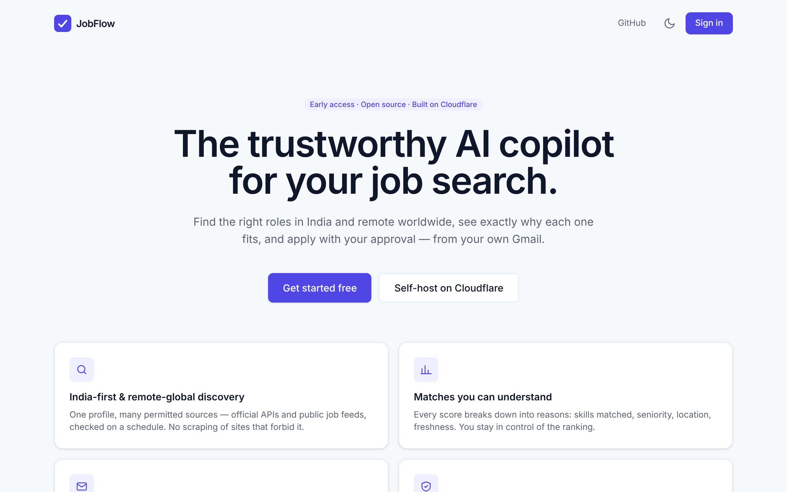
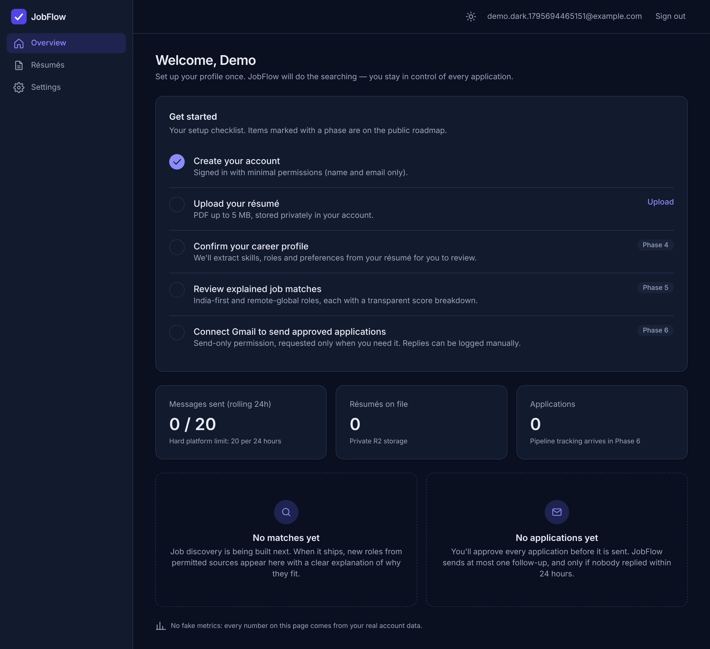
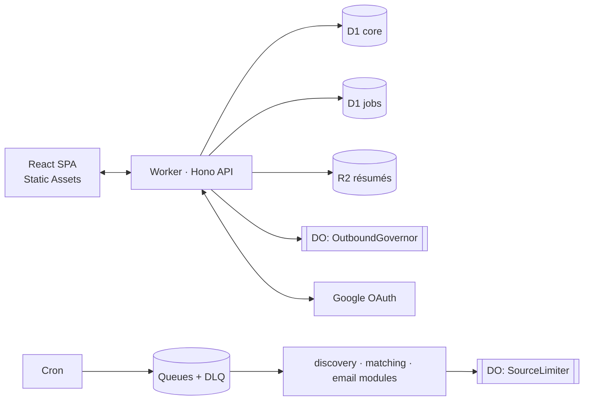

# JobFlow

**The trustworthy AI copilot for your job search: India-first, remote-global, built entirely on Cloudflare.**

[](https://github.com/aadeharshk/jobflow./actions/workflows/ci.yml)
[](https://github.com/aadeharshk/jobflow./actions/workflows/codeql.yml)
[](LICENSE)

JobFlow helps you:

- find roles from **permitted** sources;
- see **why** each role fits you;
- prepare tailored applications that you **approve** before anything is sent;
- send them from your own Gmail (send-only);
- track the outcome.

Every outbound message, including follow-ups, counts toward a hard cap of **20 per rolling 24 hours**, and you can pause everything at any time.

> **Status: Phase 3 (foundation) complete, awaiting review.** Sign-in, user management, résumé storage, the sending guard rails and the full Cloudflare platform are working and tested. Job discovery (Phase 4), matching (Phase 5) and Gmail sending (Phase 6) come next. See the [roadmap](docs/product/product-roadmap.md). "JobFlow" is a provisional name ([brand check](docs/product/brand-name-check.md)).

| Landing                                        | Dashboard (dark)                                          |
| ---------------------------------------------- | --------------------------------------------------------- |
|  |  |

## What works today (Phase 3)

- **Google sign-in.** OIDC with PKCE and only the `openid email profile` scopes. Sessions use hashed tokens with sliding expiry, and you can revoke individual sessions or every other device.
- **User management.** Edit your profile (country, time zone), view an activity feed, export all your data as JSON, and permanently delete your account (D1 rows, R2 files and Durable Object state).
- **Private résumé storage in R2.** Upload checks the PDF's magic bytes, enforces size and count limits, and checks ownership. Download and delete work as expected.
- **Sending guard rails.** An `OutboundGovernor` Durable Object enforces the 20-per-rolling-24h cap, a pause switch, idempotency and user caps from 0 to 20, and it holds under concurrency (tested with 35 parallel requests).
- **Platform.** Two D1 databases with migrations, R2, four queues plus a dead-letter queue, two Durable Objects, two Cron Triggers, Rate Limiting, Secrets, and fail-closed configuration checks.
- **Extension points.** Discovery adapters must declare compliance metadata to register (the database refuses to enable an unreviewed source, and LinkedIn, Indeed and Glassdoor are blocked hosts). Matching, send-only email and application-pipeline contracts are defined.
- **UI.** Responsive and accessible, with light and dark themes. Onboarding checklist, résumés page, settings page. No fake metrics.

## Quick start (local, ~5 minutes)

```bash
npm install -g npm@11.21.2      # required: npm 10 has a resolver bug with vitest 4
npm ci
cp .dev.vars.example .dev.vars  # enables passwordless dev sign-in locally
npm run db:migrate:local
npm run dev                     # http://localhost:8787
```

Everything runs locally on Miniflare (D1, R2, Queues and Durable Objects), so no Cloudflare account is needed for development.

## Deploy to your own Cloudflare account

```bash
npx wrangler login
npm run cf:setup                # creates D1, R2 and Queues; prints the IDs for wrangler.jsonc
npx wrangler secret put GOOGLE_CLIENT_ID
npx wrangler secret put GOOGLE_CLIENT_SECRET
openssl rand -base64 32 | npx wrangler secret put TOKEN_ENCRYPTION_KEY
npm run db:migrate:remote && npm run deploy
```

Full guide: [`docs/deployment/cloudflare-deployment.md`](docs/deployment/cloudflare-deployment.md) · Checklist: [`docs/deployment/deployment-checklist.md`](docs/deployment/deployment-checklist.md) · What needs a paid plan: [`docs/architecture/free-tier-and-paid-features.md`](docs/architecture/free-tier-and-paid-features.md)

## Architecture



```text
worker/src/
  app.ts, index.ts, env.ts, middleware.ts   # entry points, config validation, security middleware
  modules/auth | users | files              # Phase 3 features
  modules/governor | limiter                # Durable Objects
  modules/discovery | matching | email | applications   # extension points for later phases
  queues/  db/  lib/
web/src/                                    # React SPA (pages, components, design tokens)
migrations/core | jobs                      # D1 SQL migrations (source of truth)
```

More: [system architecture](docs/architecture/system-architecture.md) · [ADRs](docs/architecture/technology-decisions.md) · [database](docs/architecture/database.md) · [API](docs/api/README.md) · [secrets](docs/deployment/secrets-and-environment.md) · [costs](docs/architecture/cloudflare-cost-analysis.md)

## Quality

| Command               | What it does                                                                                                          |
| --------------------- | --------------------------------------------------------------------------------------------------------------------- |
| `npm run check`       | Lint, typecheck, Worker and web unit tests, production build                                                          |
| `npm run test:worker` | 70 tests inside the Workers runtime (auth, sessions, CSRF, OAuth, users, R2, Durable Objects, queues, config, crypto) |
| `npm run test:web`    | UI component and API-client tests                                                                                     |
| `npm run test:e2e`    | Playwright on desktop and mobile against a local `wrangler dev`                                                       |

CI also runs `npm audit`, dependency review (with a licence deny-list), CodeQL and Dependabot. GitHub Actions are pinned to commit SHAs.

## Principles

- **Compliance first.** Official APIs and public feeds only. No LinkedIn scraping, no CAPTCHA bypass, no stealth browsers, no automatic submission of third-party application forms.
- **Human in the loop.** You approve every application. There is one follow-up at most, and a cap of 20 messages per 24 hours.
- **Explainable.** Every match score will break down into reasons you can read.
- **Private.** Minimal scopes, encrypted tokens, full data export and deletion.

## Research

Phase 0–1 research is in [`docs/research/`](docs/research/): 175 repositories benchmarked with a reproducible scoring method, a reuse matrix and a third-party code policy.

## Contributing & security

See [CONTRIBUTING.md](CONTRIBUTING.md), [CODE_OF_CONDUCT.md](CODE_OF_CONDUCT.md) and [SECURITY.md](SECURITY.md). Licensed under [Apache-2.0](LICENSE).
