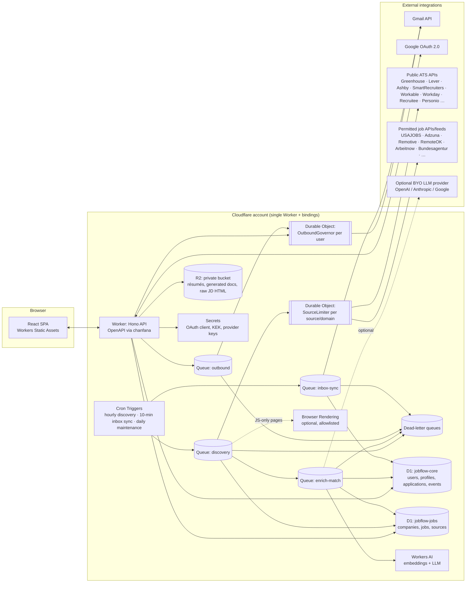

# JobFlow System Architecture (proposed, awaiting approval)

> Status: **Phase 1 proposal**. Nothing here is implemented yet. Decisions are justified in `technology-decisions.md`; costs are in `cloudflare-cost-analysis.md`.

## 1. Product in one paragraph

JobFlow is a **Global AI Job Intelligence & Application Automation Platform**. A user builds one career profile. JobFlow then checks permitted job sources around the world on a schedule and ranks every new role against the profile with an explainable score. It finds the direct employer application link and any publicly published hiring contact, and prepares a tailored résumé, cover letter and email. After the user approves, it sends the email from the user's own Gmail. It watches for genuine replies, sends **at most one** follow-up after 24 hours if no one answers, and reports the funnel: applications → responses → interviews. Every outbound message counts toward a hard limit of **20 messages per rolling 24 hours**. The user can pause everything at any time.

## 2. High-level diagram



**One Worker, multiple entry points.** The `fetch` handler serves the API and static assets, `scheduled` handles Cron, and `queue` consumes all four queues. Durable Object classes are exported from the same Worker. This keeps deployment to a single `wrangler deploy`, which matters for contributors running JobFlow on their own account.

## 3. Core flows

### 3.1 Onboarding (target: first value in under 5 minutes)

1. **Sign in with Google.** Only the `openid email profile` scopes at this step; no Gmail access yet.
2. **Upload a résumé PDF.** It is stored in R2 (`users/{id}/resumes/{uuid}.pdf`). `unpdf` extracts the text, and the LLM maps it into a structured profile (Zod-validated).
3. **Confirm the profile.** The user edits roles, skills, years of experience, locations, remote preference, work authorisation, salary floor and target seniority. Nothing is used until the user confirms it.
4. **Instant first results.** JobFlow searches the existing shared job index (already ingested for all users) and shows the top matches with score breakdowns. This is the moment the user sees value.
5. **Connect Gmail (optional, incremental).** Only when the user wants to send. JobFlow asks for the Gmail scopes with a clear explanation (ADR-007).

### 3.2 Discovery (hourly, source-aware)

```text
cron(0 * * * *) ─▶ select sources due (next_check_at <= now, enabled, terms_reviewed)
                ─▶ enqueue {source_id, cursor} on `discovery`
queue consumer ─▶ SourceLimiter DO grants a token (per-source rate + per-domain politeness)
               ─▶ fetch with ETag / If-Modified-Since → 304 = no work
               ─▶ normalise to Job schema, content-hash, upsert changed rows only
               ─▶ mark disappeared jobs `closed_at` (liveness)
               ─▶ enqueue changed job IDs on `enrich-match`
```

- Each source row stores `min_interval_minutes`. The default is 60, but it is raised when a source's documented limits or terms ask for less frequent polling. "Hourly" therefore means *hourly where permitted*.
- Company boards are tiered. Companies that posted in the last 14 days are checked every hour; others drop back to every 6 hours. This keeps queue volume roughly proportional to hiring activity.
- Jobs are **shared across users**. Each source is fetched once, however many users JobFlow has. This is the main cost and scale lever.
- Career-page discovery: given a company domain, JobFlow checks robots.txt, fetches `/careers`-style pages, detects the ATS vendor from links or iframes (pattern adapted from the ats-scrapers discovery rules), and records the board slug so future fetches use the public API.

### 3.3 Matching (transparent ranking)

For each changed job, against the users whose saved searches pass the hard filters:

| Component | Weight (default) | Explanation shown to user |
|---|---:|---|
| Hard filters | gate | "Excluded: requires on-site in Berlin; you chose remote-only" |
| Title & seniority fit | 25 | "Senior Data Engineer ≈ your target 'Data Engineer (mid–senior)'" |
| Skills overlap (lexical, FTS5 + synonyms) | 30 | "Matched 7/10 required skills: SQL, Python, Airflow… Missing: dbt, Snowflake" |
| Semantic similarity (embeddings, `bge-m3`) | 20 | "Responsibilities closely match your 'Pipelines at X' experience" |
| Location / remote / time zone | 10 | "Remote (EMEA) — compatible with IST ±5h" |
| Freshness & liveness | 10 | "Posted 6 h ago, still open" |
| Salary & sponsorship signals | 5 | "Salary range disclosed; above your floor" |

Embeddings are stored as compact `BLOB`s in D1 (jobs DB). Similarity is computed in the Worker over the candidate set left after the filters and FTS5 (typically ≤ 500 rows). An optional LLM rubric re-ranks only the top 20 per user per day, which keeps AI cost bounded. Vectorize is an optional later upgrade if candidate sets grow (see ADR-005).

### 3.4 Application preparation & approval

1. The user opens a job and clicks **Prepare**.
2. JobFlow resolves the **direct application link** (employer ATS URL), preferring it over any aggregator URL.
3. It finds **public contacts**: addresses printed in the posting, JSON-LD, or the company careers/contact page. Each is stored with `source_url` and `captured_at`. If nothing is found, JobFlow says so and recommends the ATS link. It never guesses an address.
4. It generates a tailored résumé (DOCX/PDF stored in R2), a cover letter and an email draft. A second **fact-check pass** rejects any claim not supported by the profile.
5. The user edits and clicks **Approve & queue**. Nothing is sent without this explicit approval per application. Optional "auto-send approved drafts" is a later, opt-in setting and still respects all limits.

### 3.5 Sending (governed)

```text
API ─▶ outbound queue {application_id, kind: initial|followup, idempotency_key}
consumer ─▶ OutboundGovernor(user).requestSend()
             • paused?                       → reject (state = paused)
             • ≥20 sends in last 24h ledger? → defer; reschedule at oldest_send + 24h
             • duplicate idempotency key?    → no-op
             • recipient on suppression list (bounced / opted-out)? → reject
          ─▶ refresh Gmail access token if needed (decrypt refresh token)
          ─▶ build MIME (text + optional HTML, résumé attachment from R2)
          ─▶ gmail.users.messages.send → store gmail_message_id, thread_id
          ─▶ ledger.append(now) ; event 'email_sent'
          ─▶ schedule follow-up check alarm at sent_at + 24h (only for kind=initial)
```

The Durable Object makes the 20/24h rule **strongly consistent per user**, even under concurrent queue consumers. D1 alone could not guarantee that without races.

### 3.6 Reply detection & the single follow-up

- Every 10 minutes Cron enqueues users with active threads. The consumer calls Gmail `history.list` from the stored `historyId` (cheap and incremental) and inspects only messages whose `threadId` matches a JobFlow-sent thread.
- A **genuine reply** is a message in the thread that is not from the user, not an auto-reply (RFC 3834 `Auto-Submitted` ≠ `no`, `X-Autoreply`, `X-Autorespond`, `Precedence: auto_reply|bulk|junk`, common out-of-office subjects), and not a bounce (`mailer-daemon@`, `postmaster@`, multipart/report DSN).
  - A bounce marks the address **undeliverable** and adds it to the user's suppression list.
  - An auto-reply is logged but does **not** count as a reply.
- Genuine replies are quote-stripped (email-reply-parser), then classified by the LLM (`interview_invite | rejection | request_info | positive_other | neutral_other`) with a confidence score. Low confidence asks the user to label it, and those labels improve prompts later.
- **Follow-up rule:** at `sent_at + 24h` the DO alarm checks the thread. If there is no genuine reply, the user has not disabled follow-ups, the application is not withdrawn, `followup_count = 0` and the governor allows it, JobFlow sends **one** polite follow-up in the same thread (`In-Reply-To`/`References`). There is never a second automated follow-up.

## 4. Data model (D1, abridged)

Two databases keep each under D1's 10 GB per-database limit and separate shared public data from private user data.

**`jobflow-jobs` (shared, public-source data)**
- `sources(id, kind, name, base_url, access_method, terms_url, terms_reviewed_at, min_interval_minutes, next_check_at, etag, last_status, enabled)`
- `companies(id, name, domain, ats_vendor, ats_slug, careers_url, country, last_seen_at)`
- `jobs(id, source_id, company_id, external_id, title, normalized_title, seniority, employment_type, locations_json, remote_type, countries_json, salary_min, salary_max, salary_currency, salary_period, description_text, description_r2_key, apply_url, posted_at, first_seen_at, last_seen_at, closed_at, content_hash, embedding BLOB)` with a unique key `(source_id, external_id)` and indexes on `(closed_at, posted_at)` and `(company_id)`
- `jobs_fts` (FTS5 over title, skills and description excerpt)
- `public_contacts(id, company_id, job_id NULL, email, name NULL, role NULL, source_url, captured_at, method)`. `method ∈ {posting_text, json_ld, careers_page}`

**`jobflow-core` (private user data)**
- `users`, `sessions`, `accounts` (better-auth tables)
- `google_connections(user_id, scopes, refresh_token_ciphertext, dek_wrapped, history_id, connected_at, revoked_at)`
- `profiles(user_id, headline, summary, years_experience, skills_json, experience_json, education_json, locations_json, remote_pref, work_auth_json, salary_floor, seniority_targets_json, confirmed_at)`
- `resumes(id, user_id, r2_key, kind {original|tailored}, job_id NULL, created_at)`
- `saved_searches(id, user_id, query_json, alert_frequency)`
- `matches(user_id, job_id, score, breakdown_json, computed_at, state {new|seen|saved|dismissed})`
- `applications(id, user_id, job_id, status, apply_url, contact_id NULL, approved_at, created_at, updated_at)`
- `messages(id, application_id, kind {initial|followup}, gmail_message_id, gmail_thread_id, to_email, subject, sent_at, status {queued|sent|deferred|failed|bounced}, idempotency_key UNIQUE)`
- `replies(id, application_id, gmail_message_id, received_at, classification, confidence, is_auto_reply, is_bounce, user_label NULL)`
- `suppressions(user_id, email, reason, created_at)`
- `automation_settings(user_id, paused, followups_enabled, daily_cap ≤ 20, quiet_hours_json)`
- `events(id, user_id, name, props_json, created_at)`: first-party product analytics and the user-visible activity log
- `audit_log(id, user_id, actor, action, target, created_at)`: security-relevant actions (connect/disconnect Gmail, exports, deletions)

The full schema and migrations will live in `migrations/` with documentation in `docs/architecture/database.md` (Phase 3).

## 5. Security & privacy architecture

| Concern | Control |
|---|---|
| Google refresh tokens | Envelope encryption: a per-user data key (AES-256-GCM, Web Crypto) encrypts the token, and the data key is wrapped by a key-encryption key held in **Cloudflare Secrets**. Ciphertext only in D1. Key rotation by re-wrapping |
| Least privilege | Sign-in uses only `openid email profile`. Gmail scopes are requested incrementally and only when the user enables sending. Read access is scoped to thread checks (ADR-007) |
| Data minimisation | JobFlow stores message IDs, thread IDs, headers needed for classification, and the quote-stripped reply text (user-deletable). It never stores the user's unrelated mail |
| Résumé files | Private R2 bucket; access only through authenticated Worker routes that check ownership; no public URLs |
| Web security | Secure, HttpOnly, SameSite=Lax session cookies; CSRF protection on state-changing routes; strict CSP; `secure-headers` middleware; input validated with Zod |
| Abuse prevention | 20/24h governor, per-recipient de-duplication (no second initial email to the same address within 30 days), suppression list, pause switch, rate-limited API (Workers Rate Limiting binding) |
| Compliance with sites | Source registry with `terms_reviewed_at`; robots.txt honoured; identifiable User-Agent with a contact URL; no CAPTCHA solving, no stealth browsers, no logged-in third-party automation, no LinkedIn scraping |
| LLM safety | Job descriptions and emails are untrusted input. Prompts isolate them as data; outputs are schema-validated; generated claims are checked against the profile |
| User rights | Export all data (JSON + files ZIP); delete account (D1 rows, R2 objects, revoke Google token) |
| Observability | Workers Logs with PII redaction; error tracking via `console.error` + Logpush (optional); alerting on DLQ depth |

## 6. Repository layout (proposed)

```text
jobflow/
├─ apps/web/                 # React + Vite SPA (Workers Static Assets)
├─ worker/
│  ├─ src/index.ts           # fetch / scheduled / queue entry points
│  ├─ src/api/               # Hono routes (chanfana OpenAPI)
│  ├─ src/discovery/         # source adapters (greenhouse.ts, lever.ts, …) + registry
│  ├─ src/matching/          # filters, lexical, embeddings, explainer
│  ├─ src/email/             # gmail client, mime builder, reply detection, classifier
│  ├─ src/governor/          # OutboundGovernor DO
│  ├─ src/limiter/           # SourceLimiter DO
│  ├─ src/db/                # Drizzle schemas (core.ts, jobs.ts)
│  └─ test/                  # vitest-pool-workers tests + fixtures (recorded API responses)
├─ migrations/{core,jobs}/   # SQL migrations
├─ e2e/                      # Playwright
├─ docs/                     # research, architecture, product, API
├─ scripts/research/         # reproducible research tooling
└─ wrangler.jsonc
```

## 7. Non-goals (v1)

- Automatically submitting third-party application forms.
- Scraping LinkedIn or any site whose terms forbid automated access.
- Bulk or cold "spray" outreach beyond the 20/24h cap.
- Storing or reading mail unrelated to JobFlow-sent threads.
- Supporting non-Gmail mailboxes (Outlook/IMAP is a later phase, as an adapter behind the same governor).
